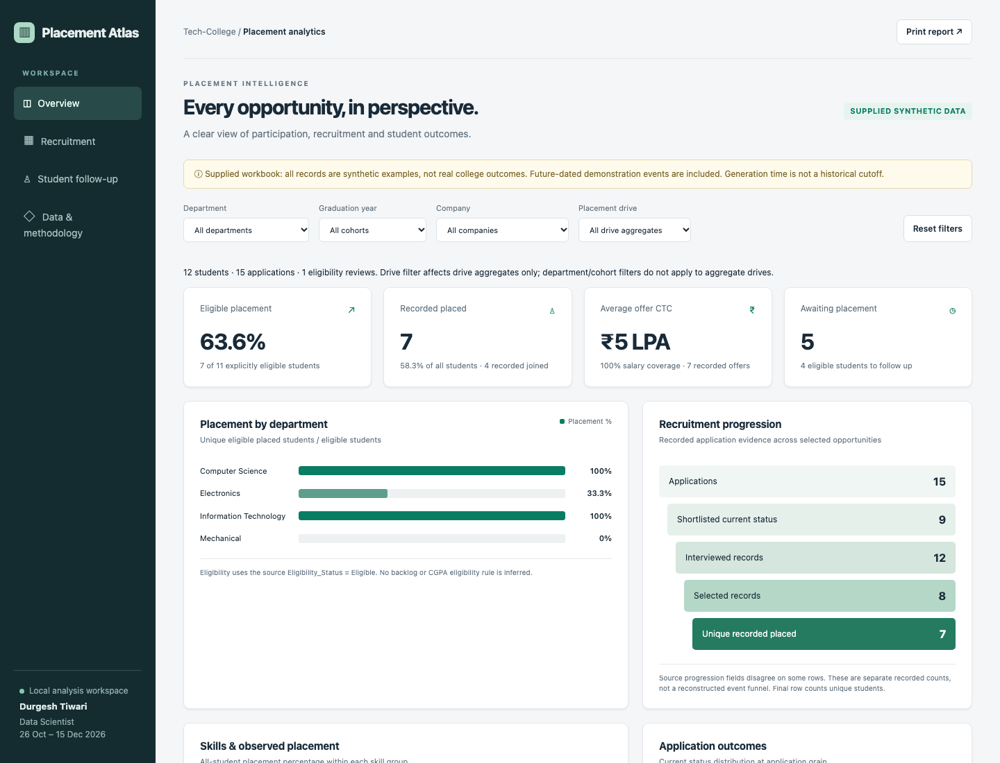

# Placement Atlas · Tech-College Placement Analytics

**Durgesh Tiwari · Data Scientist · Assigned: 26 October–15 December 2026**

Analytics implementation covering requirements, cleaning, EDA, recruiter/drive analytics, KPIs, follow-up, dashboard, validation and final documentation. Eight cumulative weekly branches and 51 daily task commits follow the assignment. Assigned dates are task labels; Git records actual implementation time.

**The supplied workbook exports are explicitly synthetic. These findings do not represent real college results.** Future-dated demonstration events are included and disclosed. Real institutional findings require authorized real datasets and placement-cell review.



## Open the deliverables

**Live dashboard:** [durgeshtiw98.github.io/collegeplacement](https://durgeshtiw98.github.io/collegeplacement/). Use **Download reports** for the reports, CSV summaries and JSON audit files.

Download the repository and open [the dashboard](reports/supplied/dashboard.html) in a browser. It works offline with department, cohort and company filters, separate aggregate-drive filtering, recruitment views, student search, CSV downloads and printing. GitHub source view does not execute HTML.

Read the [final report](reports/supplied/06-final-report.md), [requirements](docs/data-requirements.md) and [methodology](docs/methodology.md). Original source exports are preserved in data/raw; cleaned synthetic CSVs and their audit are in data/cleaned-supplied.

## Reproduce

Python 3.11+. The new analytics command uses only the standard library:

```sh
PYTHONPATH=src python3 -m placement supplied
```

This writes cleaned CSV, SQLite and quality findings to data/processed-supplied and all six reports, supporting CSV/JSON and dashboard to reports/supplied.

For authorized replacement exports with the same headers:

```sh
PYTHONPATH=src python3 -m placement supplied --input /path/to/authorized-exports --processed data/processed-supplied --output reports/generated
```

Keep source, processed and report directories separate. Real source and output directories are ignored by Git. The public repository contains only supplied synthetic records and generated synthetic artifacts. Review staged files before publishing replacement data. Retain accurate Read_Me provenance.

## Deliverables

| Deliverable | Files |
| --- | --- |
| Requirements/preparation | docs/data-requirements.md, docs/methodology.md, reports/supplied/01-data-preparation.md |
| Cleaned data | data/cleaned-supplied; reproducible SQLite in data/processed-supplied |
| EDA | reports/supplied/02-exploratory-analysis.md, skills.csv, cgpa_bands.csv |
| Recruiter/drive analytics | reports/supplied/03-recruiter-drive-analysis.md, companies.csv, drives.csv |
| KPI performance | reports/supplied/04-placement-performance.md, departments.csv, history.csv, follow_up.csv |
| Dashboard | reports/supplied/dashboard.html, docs/screenshots |
| Final documentation | reports/supplied/05-validation-insights.md, 06-final-report.md, analysis.json, quality.json, docs/weekly |

## Supplied-data results and interpretation

12 students; 11 explicitly eligible; 7 recorded placed eligible students: **63.64%**. Seven recorded offers average **₹5 LPA**, highest **₹6 LPA**. Four students are recorded joined. These are distinct source facts.

Placement uses unique students with Applications.Placement_Status = Placed; eligibility uses Student_Data.Eligibility_Status. Company selection uses selected applications / applications. Drive participation uses attendees / registrations; drive selection uses selected / attendees. Salaries describe recorded offers, not inferred acceptance. N/A includes zero denominators.

No reliable offer/application or application/drive keys, individual drive attendance or individual recruiter activity are available. Historical populations differ from the current example. Department/cohort filters therefore apply to student/application records, company filters use available links, and drive filters affect aggregate drive data only. Limitations appear in the interface and reports.

## Eight weekly branches

| Branch | Assigned range | Focus |
| --- | --- | --- |
| week-01_2026-10-26_to_2026-11-01 | 26 Oct–1 Nov | Requirements and plan |
| week-02_2026-11-02_to_2026-11-08 | 2–8 Nov | Data collection and preparation |
| week-03_2026-11-09_to_2026-11-15 | 9–15 Nov | EDA |
| week-04_2026-11-16_to_2026-11-22 | 16–22 Nov | Recruiter and drive analytics |
| week-05_2026-11-23_to_2026-11-29 | 23–29 Nov | KPIs and performance |
| week-06_2026-11-30_to_2026-12-06 | 30 Nov–6 Dec | Dashboard |
| week-07_2026-12-07_to_2026-12-13 | 7–13 Dec | Validation and recommendations |
| week-08_2026-12-14_to_2026-12-15 | 14–15 Dec | Documentation and submission |

main contains the complete implementation. Branches are cumulative checkpoints. Daily evidence gives assigned date, actual preparation timestamp and concrete artifacts. These are implementations prepared ahead of the schedule, not evidence of work performed on future dates or coordinator approval. Foundation code can support later phases before their reports are introduced.

## Verify

```sh
python3 -m venv .venv
.venv/bin/python -m pip install -r requirements.txt -r requirements-dev.txt
PYTHONPATH=src .venv/bin/coverage run -m unittest discover -s tests -v
.venv/bin/coverage report
.venv/bin/python -m pip_audit -r requirements.txt
node tests/browser-smoke.mjs
```

Browser tests use local Chrome (override CHROME_BIN if needed) and check desktop/mobile navigation, filters, search, downloads and layout. No Node packages are needed. CI checks Python tests with a minimum 80% coverage requirement, audits dependencies and uploads regenerated synthetic reports. See docs/validation.md for verification evidence.

## Future normalized exports

The [optional normalized contract](docs/normalized-contract.md) and data/templates define eight CSV tables with actual recruiter, registration and offer/application keys. This separate mode uses a documented academic eligibility proxy and accepted/joined offers for placement:

```sh
PYTHONPATH=src python3 -m placement templates
PYTHONPATH=src python3 -m placement demo
PYTHONPATH=src python3 -m placement run --demo
PYTHONPATH=src python3 -m placement validate --demo
```

The primary assignment reports use the original supplied workbook, not the additional generated fixtures.

## Existing Word reporting

The original pipeline, Word template and scheduled Thursday/Friday/final workflow remain available. Install requirements.txt for Word report generation. The scheduled workflow also produces the new supplied-source reports. Scheduling depends on GitHub Actions availability; no future run is claimed to have occurred.

## GitHub Pages deployment

The `Deploy dashboard to GitHub Pages` workflow regenerates the supplied-data analysis and publishes the static dashboard and report downloads when relevant files change on main. It can also be run manually from Actions. The eight weekly branches remain cumulative assignment checkpoints.

To package the website locally, run `python3 scripts/build_pages.py` after generating the supplied reports. Output goes to the ignored `_site/` directory. GitHub Pages hosts the HTML/JavaScript and report files; the Python analysis runs during the Actions build.
